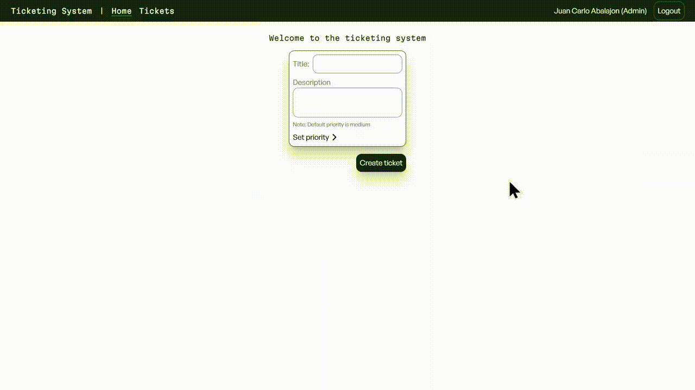

# Live Demo
https://www.ticketing-system.online

# Akinto Ticketing System

A ticketing system for teams. This can improve efficiency and coordination of teams. There are three roles: requesters, agents, and admin. Requesters can create tickets but cannot edit or delete them once the ticket has been created. All roles can comment on the comment section to discuss and clarify any agendas involving that particular ticket. 

# Features

- Role-based access control
- Ticket creation and management
- Secure Authentication using laravel sanctum
- Threaded comments

# Demos

`Creating ticket`




# Future plan

Right now, the only difference between agents and admin, is that an admin can delete tickets. I am planning to add a rule for agents where they can only assign themselves(not other agents) to openly available tickets while an admin can assign any agent to any ticket.

# Teck Stack

PHP | Tailwind CSS | PostgreSQL | Laravel(PHP framework) | Vite | TypeScript/JavaScript | Vue.js | Pinia

# Deployment

**Backend:** Digital Ocean Droplet
**Frontend:** Vercel

## Getting Started

## Prerequisites

- Node.js && npm
- PostgreSQL
- composer 

### 1. Clone & Install

```bash
git clone https://github.com/Azure2009/Ticketing-System.git

cd Ticketing_System

#Backend dependencies
cd backend
composer install 


#Frontend dependencies
cd ../frontend 
npm install

```

### 2. Create database 

```bash

createdb ticketing_system

```

### 3. Configure your environmental variables

Copy and paste the contents of `backend/env.example` to your .env file.

`backend/.env`:

```bash

#Only update these keys:

APP_KEY=

DB_CONNECTION=psql
DB_HOST=127.0.0.1
DB_PORT=5432
DB_DATABASE=ticketing_system
DB_USERNAME=your-username
DB_PASSWORD=your-password

```

Generate the APP_KEY. Run this in your backend directory:

```bash
php artisan key:generate
```

`frontend/.env.development`:
 
```bash
VITE_API_URL=http://localhost:8000/api
VITE_API_BASE_URL=http://localhost:8000
```
### 4. Setup database migration

The database schema is managed through Laravel migrations. You do not need to create the tables manually.

From the `backend` directory, run:

```bash
php artisan migrate
```

### 5. Run it
 
```bash
# terminal 1
cd backend && php artisan serve
 
# terminal 2
cd frontend && npm run dev
```

Open http://localhost:5173, note: all newly registered users default role is a requester

### Testing Different Roles

If you want to try the other roles, update the role column in the database.

`Once you are connected to PostgreSQL, run`:

```bash

\c ticketing_system

```

Check the available users:

```sql
SELECT * FROM users;
```

Update the user's role:

```sql
UPDATE users SET role = <new-role> WHERE id = <the-user-id>
```

## Author
 
Juan Carlo · [GitHub](https://github.com/Azure2009) · [LinkedIn](https://www.linkedin.com/in/juan-carlo-abalajon)


